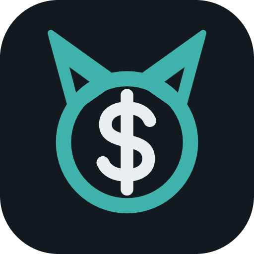
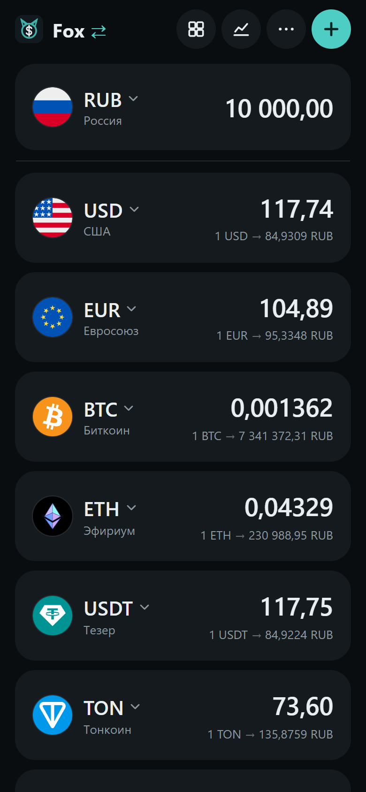
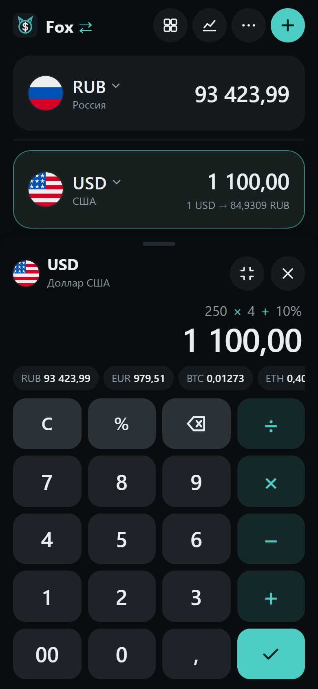
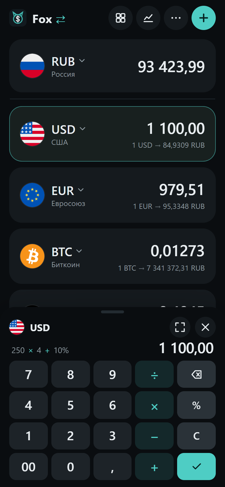
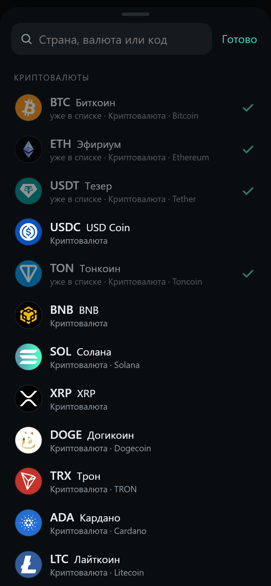
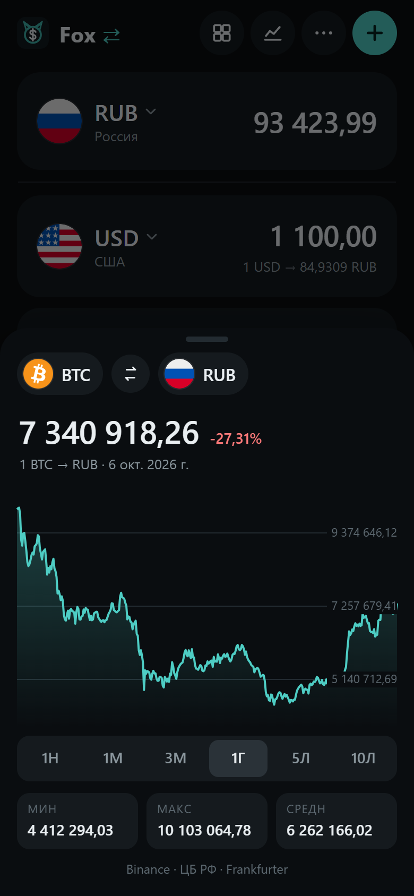
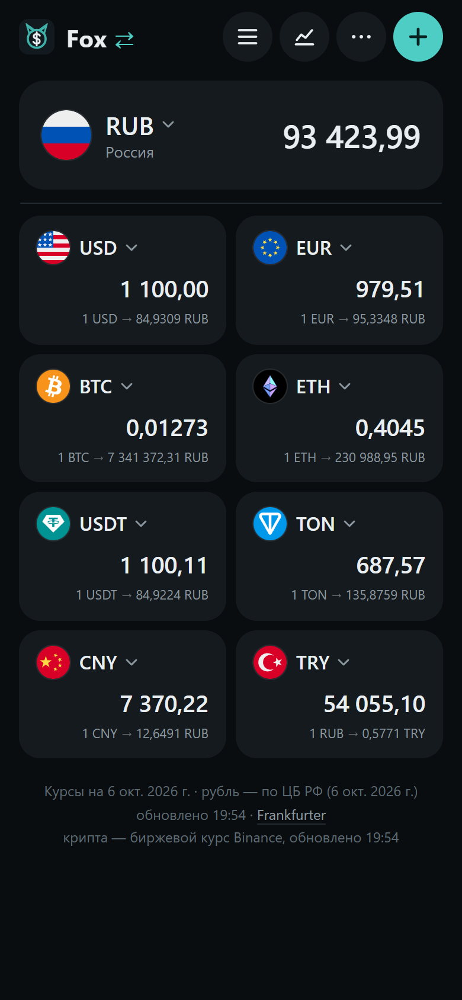
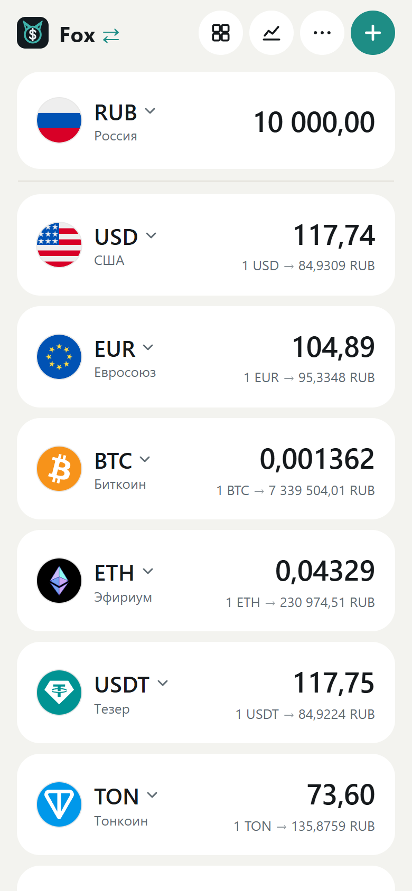

# Fox ⇄

**Currency and crypto converter with a calculator in the amount field.**

165 currencies and 24 cryptocurrencies on one screen. Type an amount in any of them — every other one recalculates as you type.

**English** · [Русский](README.ru.md)

Open the site, add your currencies once. After that: tap an amount, type — done.

- **Currencies and crypto together** — 165 world currencies, gold, silver, platinum and palladium, plus 24 cryptocurrencies: BTC, ETH, USDT, USDC, TON, BNB, SOL, XRP, DOGE, TRX, LTC and more. Every pair works both ways: BTC → RUB, USDT → EUR, TON → TRY.
- **Calculator right in the amount field** — `+ − × ÷` and percentages (`100 + 10%` = 110). The result appears in every currency while you type. A compact keypad takes half the screen, so the list stays visible.
- **The ruble at the Bank of Russia rate** — every pair with RUB uses the official CBR rate, crypto included (coin → USD → RUB at the CBR rate). Other currencies come from the ECB and central banks, crypto from live Binance prices refreshed every minute.
- **Search the way you think** — by country, currency name or code, in Russian and English: “лира”, “Turkey”, “TRY”, “биток”, “эфир”, “тон”.
- **Gestures** — swipe a card right to make it the main currency, left to remove it, long-press and drag to reorder, pinch for tiles.
- **Charts** — any pair from one week to ten years; drag a finger along the line to see the rate on a given day.
- **An app, not a page** — installs on iPhone and Android, works offline with the last saved rates, dark and light themes, Russian and English.

## Get started

1. Open **[fx.byfox.dev](https://fx.byfox.dev/)**
2. iPhone: Safari → **Share** → **Add to Home Screen**. Android: Chrome → **Install app**.
3. Tap **+** and add your currencies

Free, no sign-up, no trackers or analytics. Rates: [Frankfurter](https://frankfurter.dev/) (ECB and central banks, RUB by the Bank of Russia) and [Binance](https://www.binance.com/) for crypto. Official end-of-day rates for currencies, market prices for crypto — not a trading terminal. This repository hosts the page only.

---

Keywords: currency converter, crypto converter, bitcoin to ruble, USDT to RUB, CBR exchange rate, currency calculator, PWA currency app, offline exchange rates.
